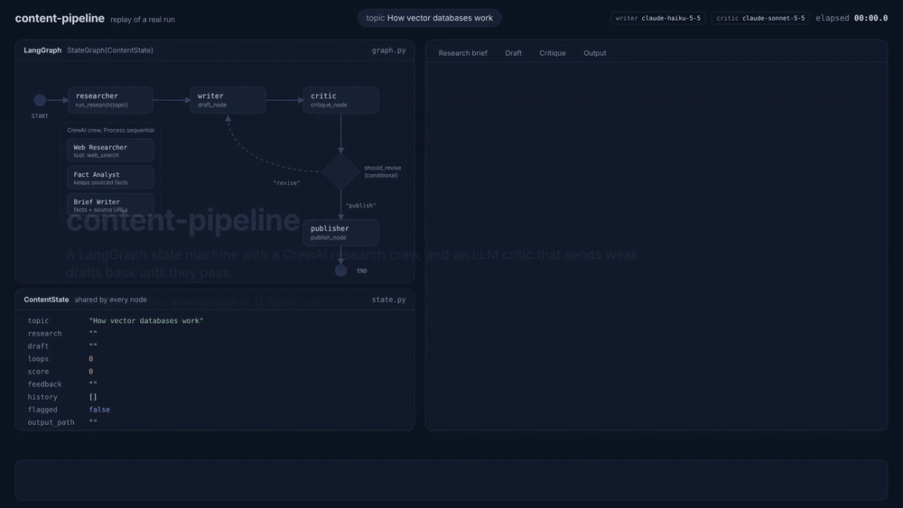
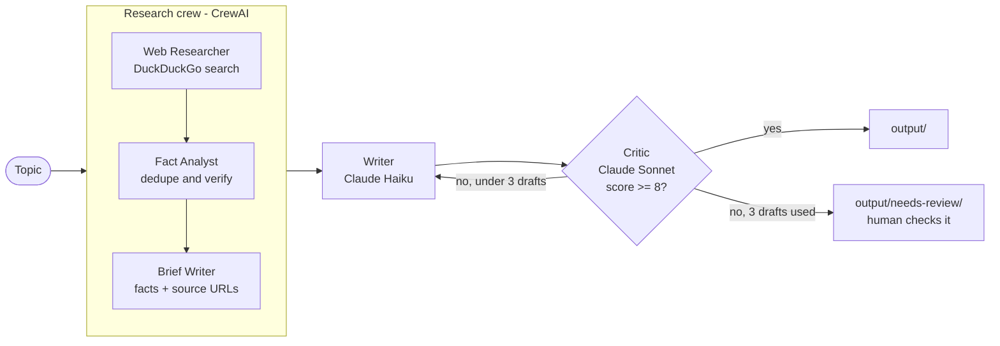

# Self-Correcting Research & Writing Pipeline


**An agentic pipeline that researches a topic on the web, writes a cited article, and refuses to publish it until an independent AI critic scores it atleast 8/10, escalating to a human if it can't get there in 3 drafts.**



<sub>Replay of a real run, built from <a href="examples/2026-10-11-170949.json">its run record</a>. Full-quality video below.</sub>

| | |
|---|---|
| **+3.0 points** | average quality gain when the critic sends a draft back. Best case **2 → 9**, after the critic caught an invented statistic |
| **50%** | of first drafts were rejected and revised, so the loop does real work |
| **< $0.06** | per researched, source-cited article, in **74 seconds** on average |
| **13 tests** | run on every push with fake LLMs: zero API cost |

---

## See it work

One real run, topic *"How vector databases work"* ([full article](examples/2026-10-11-1709-how-vector-databases-work.md) · [full run record](examples/2026-10-11-170949.json)):

**Draft 1 scored 2/10.** The critic caught invented facts:
> "The article says 'A typical embedding has hundreds or thousands of dimensions'. This is a specific numerical claim that is not in the research (-3)."
>
> "The article says 'AI/TLDR describes this trade-off as the central bargain behind practical similarity search'. The research only says ANN trades a little exactness for a large speed gain... so the attribution is invented (-3)."

**Draft 2 scored 9/10** and was published. The writer removed the invented number but kept the explanation:

| Draft 1 | Final |
|---|---|
| "A typical embedding has hundreds or thousands of dimensions" | "An embedding has many dimensions, far more than the three we can easily picture" |

The final article opens:
> Traditional databases are built to find exact matches. You ask for every customer whose postcode is 10001, and the system returns the rows that match. Much of the world's data, including text, images, audio, and product descriptions, has no obvious structure for that kind of lookup.

Every factual claim in the final article traces back to a source URL found by the research crew.

---

## Architecture



- **CrewAI** runs the research as a team: one agent searches, a sceptical second agent keeps only facts a source actually states, and a third writes a brief where every fact carries its URL.
- **LangGraph** runs the quality loop: write → critique → route, with a hard cap of 3 drafts.
- **A stronger model judges than writes.** Haiku drafts cheaply; Sonnet critiques, the one decision where quality matters most.

---

## What broke, and how I fixed it

Building a reliable LLM judge was the hard part. Every row below happened during development and is visible in the [tagged history](https://github.com/saumyagupta2207/content-pipeline/tags).

| Problem observed | Root cause | Fix |
|---|---|---|
| A first draft with a cliché opening scored **9/10** | The judge chose a score *before* finding faults | Structured output lists `problems` **before** `score`, plus a points-deduction rubric. The same kind of draft then scored 5 |
| Asked about RAG with research that didn't cover it, the writer **retitled the article to a different topic** and passed at 8/10 | Reward hacking: the rubric never checked the topic | A **topic gate** caps off-topic articles at 3/10, whatever the polish |
| Scores **plateaued** (6→7→7, 7→6→7); the critic penalised examples, then asked for more | The rubric didn't separate facts from explanation; a small judge model struggled with "deduct X, except Y" rules | Facts must be sourced, explanation is allowed; the critic may only cite rubric rules; judge upgraded to Sonnet. Result: **3→7→8** |
| The writer filled articles with **"this is my view" disclaimers** | Reward hacking again, labelling everything to dodge deductions; the revision prompt also never received the rules | One shared `WRITER_RULES` block in both prompts, with an anti-disclaimer rule |
| Articles **silently cut off** mid-conclusion | Gemini's hidden "thinking" tokens consumed the output budget | Raised the token limit, found because the critic kept flagging "no conclusion" |
| The tutorial's 3-revision limit **could never trigger** | Its loop counter was never incremented | Counter fixed, plus a test that fails if the bug returns |
| The researcher agent slipped in a claim **"from my own knowledge"** | LLMs fill gaps from memory | The sceptical Fact Analyst agent excluded it: agents checking agents |
| Tests passed on Windows but **failed in CI** | The test folder was named `Tests`; Linux file names are case-sensitive | Renamed to `tests`. CI caught it on its first run |

**Biggest lesson:** an LLM judge's rubric is calibrated to a specific model. The same rubric was too lenient on Gemini Flash and too harsh on Claude Haiku. Change the judge and you must re-check its scores.

---

## Results

Measured across 8 runs on 7 AI/ML topics (`python -m pipeline.report`):

| Metric | Value |
|---|---|
| Passed on first draft | 4/8 (50%) |
| Needed revision | 4/8 (50%) |
| **Average score gain when revised** | **+3.0 points** |
| Average first-draft score | 6.6/10 |
| Average final score | 8.1/10 |
| Flagged for human review | 0/8 |
| Average time per article | 74s (research 54%, critique 23%, writing 22%) |

**Cost:** the entire project, including development, critic calibration and the 8 evaluation runs, used **$0.45** of API credit, so each article costs well under 6 cents.

> **Honest caveats:** 8 runs is a small sample, and scores come from an LLM judge, not human reviewers. The same topic can vary a lot between runs (one "vector databases" run passed at 8 first time; another started at 2), because research and writing are non-deterministic. That variance is exactly why a quality loop exists.

---

## Engineering highlights

- **Structured outputs:** the critic returns a validated Pydantic object in strict JSON-schema mode, with automatic retries. No regex-parsing "8/10" from prose.
- **Model routing for cost:** cheap model for generation, stronger model only for judgment.
- **Provider-agnostic:** one `.env` switch moves both frameworks between Claude and Gemini.
- **Human-in-the-loop:** articles that never pass are routed to `needs-review/`, never silently published.
- **Observability:** levelled logging, a critique history kept with a LangGraph reducer, and a JSON run record saved in a `finally` block, so **failed runs are recorded too**.
- **Tested without an API:** fake LLMs drive the real graph to verify routing, loop limits, flagging and feedback flow; CI runs them on every push.

---

## Run it yourself

Requires Python 3.11–3.13 and an Anthropic or Gemini API key.

```bash
git clone https://github.com/saumyagupta2207/content-pipeline.git
cd content-pipeline
python -m venv venv
venv\Scripts\activate            # macOS/Linux: source venv/bin/activate
python -m pip install -r requirements.txt
copy .env.example .env           # macOS/Linux: cp .env.example .env  (then add your key)

python main.py "How RAG reduces hallucinations"
python -m pipeline.report        # metrics across all your runs
```

| `.env` variable | Purpose |
|---|---|
| `LLM_PROVIDER` | `anthropic` or `gemini` |
| `MODEL_NAME` | writer + research model, e.g. `claude-haiku-5-5` |
| `CRITIC_MODEL` | judge model, e.g. `claude-sonnet-5-5` (defaults to `MODEL_NAME`) |
| `LOG_LEVEL` | `DEBUG` shows every problem the critic finds |

**Tests:** `python -m pip install -r requirements-dev.txt` then `python -m pytest -v`

---

## Project structure

```
pipeline/
  research.py   3-agent CrewAI research crew
  tools.py      web search tool
  nodes.py      writer, critic, router, publisher, rubric
  graph.py      LangGraph wiring
  llm.py        provider-agnostic model factories (writer / critic / crew)
  state.py      shared state with history reducer
  publish.py    Markdown + frontmatter output
  runlog.py     JSON run records
  report.py     aggregate metrics
tests/          pytest suite with fake LLMs
examples/       sample article + run record
```

## Limitations and next steps

- Research reads search snippets, not full pages. **Next:** fetch full page text.
- The critic is slightly lenient at the pass boundary. **Next:** compare LLM-judge scores with human ratings on a sample.
- Research takes 54% of runtime. **Next:** run searches in parallel.
- Cost is measured from billing. **Next:** record tokens and cost per run.

## Built step by step

Every stage is a tagged release you can browse:
[v0.1 scaffold](https://github.com/saumyagupta2207/content-pipeline/tree/v0.1) ·
[v0.2 LLM layer](https://github.com/saumyagupta2207/content-pipeline/tree/v0.2) ·
[v0.3 critique loop](https://github.com/saumyagupta2207/content-pipeline/tree/v0.3) ·
[v0.4 research crew](https://github.com/saumyagupta2207/content-pipeline/tree/v0.4) ·
[v0.4.1 judge calibration](https://github.com/saumyagupta2207/content-pipeline/tree/v0.4.1) ·
[v0.5 publishing](https://github.com/saumyagupta2207/content-pipeline/tree/v0.5) ·
[v0.6 observability](https://github.com/saumyagupta2207/content-pipeline/tree/v0.6) ·
[v0.7 tests](https://github.com/saumyagupta2207/content-pipeline/tree/v0.7) ·
[v1.0 release](https://github.com/saumyagupta2207/content-pipeline/tree/v1.0)